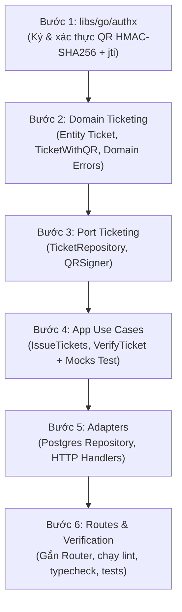

# EV-133 (EVF-38) — Kế Hoạch Thực Thi (Plan)

## 1. Thứ tự thực hiện theo kiến trúc Hexagonal-lite



| Bước | Nội dung | Lý do / Ràng buộc |
|---|---|---|
| **Bước 1** | Hiện thực `libs/go/authx` và unit test `authx/qr_test.go` | Tách biệt logic mã hóa / ký HMAC ra module dùng chung, chống timing attacks |
| **Bước 2** | Thêm domain entity `Ticket`, `TicketStatus`, `TicketClaims` và domain errors trong `services/ticketing/internal/domain` | Tầng Domain thuần túy (0 external dependencies) |
| **Bước 3** | Khai báo port `TicketRepository`, `TicketIssuanceParams`, `QRSigner` trong `services/ticketing/internal/port` | Đảo ngược phụ thuộc (DIP) |
| **Bước 4** | Viết `IssueTicketsUseCase` và `VerifyTicketUseCase` trong `services/ticketing/internal/app` cùng unit test đi kèm | Kiểm soát tính toàn vẹn, bảo vệ idempotent và 4 quy tắc bất biến |
| **Bước 5** | Hiện thực Postgres adapter cho bảng `tickets`, `orders`, `seat_holds`, `outbox_events` trong transaction và HTTP handler | Đảm bảo ACID transaction an toàn (Quy tắc 1) |
| **Bước 6** | Tích hợp vào HTTP router của ticketing-svc, chạy toàn bộ test suite và đo coverage | Đảm bảo không có lỗi hồi quy |

---

## 2. Danh sách File thay đổi

### Thêm mới
- `libs/go/authx/qr.go`
- `libs/go/authx/qr_test.go`
- `services/ticketing/internal/domain/ticket.go`
- `services/ticketing/internal/domain/ticket_test.go`
- `services/ticketing/internal/port/ticket.go`
- `services/ticketing/internal/app/issue_tickets.go`
- `services/ticketing/internal/app/issue_tickets_test.go`
- `services/ticketing/internal/app/verify_ticket.go`
- `services/ticketing/internal/app/verify_ticket_test.go`
- `services/ticketing/internal/adapter/postgres/ticket_repository.go`
- `services/ticketing/internal/adapter/postgres/ticket_repository_test.go`
- `services/ticketing/internal/adapter/http/ticket_handler.go`
- `services/ticketing/internal/adapter/http/ticket_handler_test.go`
- `docs/workflow/EV-133-issue-ticket-qr-hmac/traceability.md`
- `docs/workflow/EV-133-issue-ticket-qr-hmac/evidence.md`
- `docs/workflow/EV-133-issue-ticket-qr-hmac/code-review.md`

### Sửa đổi
- `services/ticketing/internal/domain/errors.go` (bổ sung domain error cho ticket: `ErrTamperedQR`, `ErrTicketAlreadyUsed`, `ErrTicketExpired`, `ErrOrderNotPaid`, `ErrTicketNotFound`)
- `services/ticketing/internal/adapter/http/handler.go` (đăng ký ticket routes vào HTTP router)
- `services/ticketing/cmd/server/main.go` (khởi tạo ticket use case và adapter)

### TUYỆT ĐỐI CẤM SỬA
- Các file baseline tests cũ: `services/ticketing/internal/app/create_hold_test.go`, `create_hold_bro3_test.go`, `create_hold_bro4_test.go`, `services/ticketing/internal/domain/inventory_test.go`.
- Ràng buộc chống oversell: `ticket_inventory_available_check`, Lua atomic hold scripts.
- Schema migrations cũ: `migrations/0001_core.sql`.

---

## 3. Hợp đồng API / Type Signatures

### 3.1. Thư viện `libs/go/authx`
```go
package authx

type TicketClaims struct {
    TicketID     string `json:"tid"`
    OrderID      string `json:"oid"`
    EventID      string `json:"eid"`
    TicketTypeID string `json:"tty"`
    IdentityID   string `json:"sub"`
    JTI          string `json:"jti"`
    IssuedAt     int64  `json:"iat"`
    ExpiresAt    int64  `json:"exp"`
}

type QREngine struct {
    secretKey []byte
}

func NewQREngine(secretKey []byte) *QREngine
func (e *QREngine) Sign(claims TicketClaims) (qrPayload string, signature string, err error)
func (e *QREngine) Verify(qrPayload string) (TicketClaims, error)
```

### 3.2. Domain Models (`services/ticketing/internal/domain`)
```go
type TicketStatus string

const (
    TicketStatusIssued    TicketStatus = "ISSUED"
    TicketStatusCheckedIn TicketStatus = "CHECKED_IN"
    TicketStatusVoid      TicketStatus = "VOID"
    TicketStatusRefunded  TicketStatus = "REFUNDED"
)

type Ticket struct {
    ID           string       `json:"id"`
    OrderID      string       `json:"order_id"`
    TicketTypeID string       `json:"ticket_type_id"`
    JTI          string       `json:"jti"`
    QRSig        string       `json:"qr_sig"`
    Status       TicketStatus `json:"status"`
    CheckedInAt  *time.Time   `json:"checked_in_at,omitempty"`
    CreatedAt    time.Time    `json:"created_at"`
}

type TicketWithQR struct {
    Ticket
    QRPayload string `json:"qr_payload"`
}
```

### 3.3. Port Interfaces (`services/ticketing/internal/port`)
```go
type IssueTicketsParams struct {
    OrderID string
    TraceID string
}

type IssueTicketsResult struct {
    OrderID       string
    EventID       string
    IdentityID    string
    Tickets       []domain.TicketWithQR
    AlreadyIssued bool
}

type TicketRepository interface {
    GetOrderForIssuance(ctx context.Context, orderID string) (OrderIssuanceInfo, error)
    IssueTicketsTx(ctx context.Context, order OrderIssuanceInfo, tickets []domain.Ticket, traceID string) error
    GetTicketsByOrderID(ctx context.Context, orderID string) ([]domain.Ticket, error)
    GetTicketByJTI(ctx context.Context, jti string) (domain.Ticket, error)
}
```
